<p align="center"></p>

Wild West Roleplay's gamemode has been ported to open.mp for SA-MP 0.3.DL clients. Every feature of the original is still in verbatim but rewritten on PawnPlus and split into one folder per feature, with the bugs I could find fixed. The code as I first open sourced it is on the `legacy` branch. You can read the original feature list from the legacy release at the bottom here.

This has been tested end to end on an open.mp 1.6.7 server with multiple players on 0.3DL: registering, the quiz, character creation, the shops, the inventory, poker, blackjack, wanted posters, farming, hunting, horses and the custom models, which the server now hands out through open.mp's artwork component. It uses PawnPlus tasks for queries, timers and dialogs, pools instead of fixed arrays, and pp-hooks for hooks. MySQL uses MRP's migration script so the database sets itself up on the first boot. Passwords are now hashed with bcrypt (originally sha256) so if you already have data you will have to convert it.

All 329 commands are converted and updated verbatim to their original implementation. Dialogs now use tdialogs and the textdraw menus (registration, character select, inventory, action panel, ...) are optimized but their appearance unchanged. Over 440 bugs from the original were fixed, and the systems that were never finished (telegrams, the lottery) now work. See the changes below.

| | |
|---|---|
| 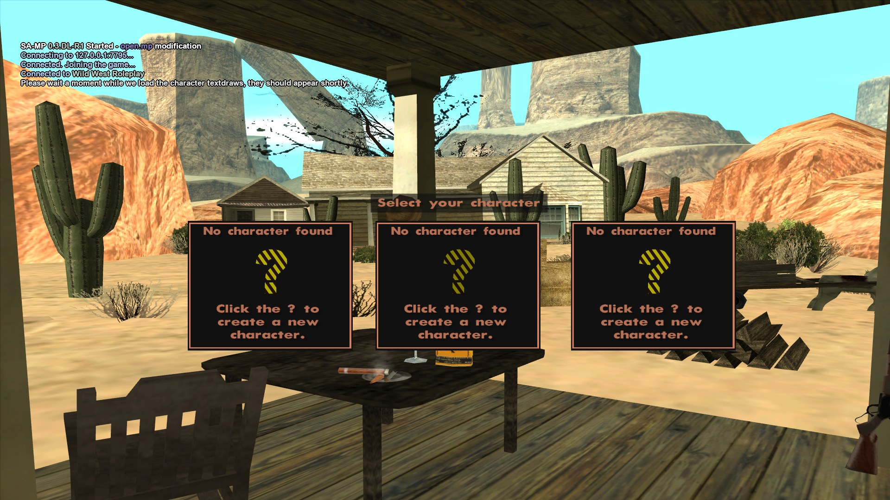 | 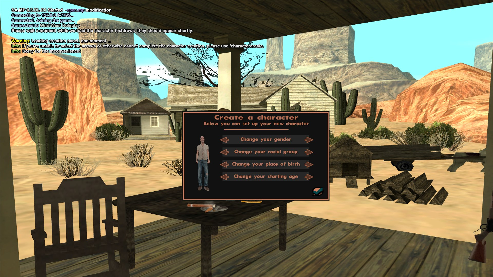 |
| 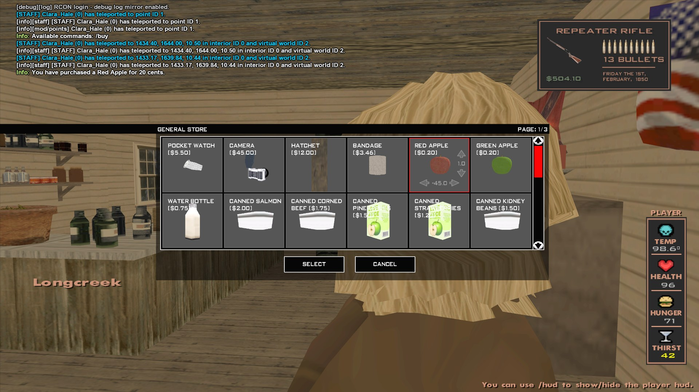 | 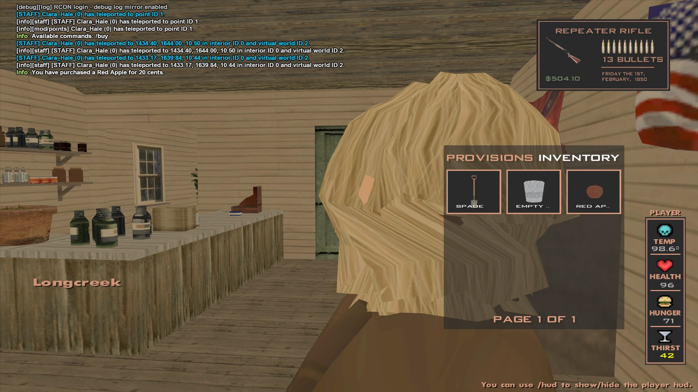 |
| 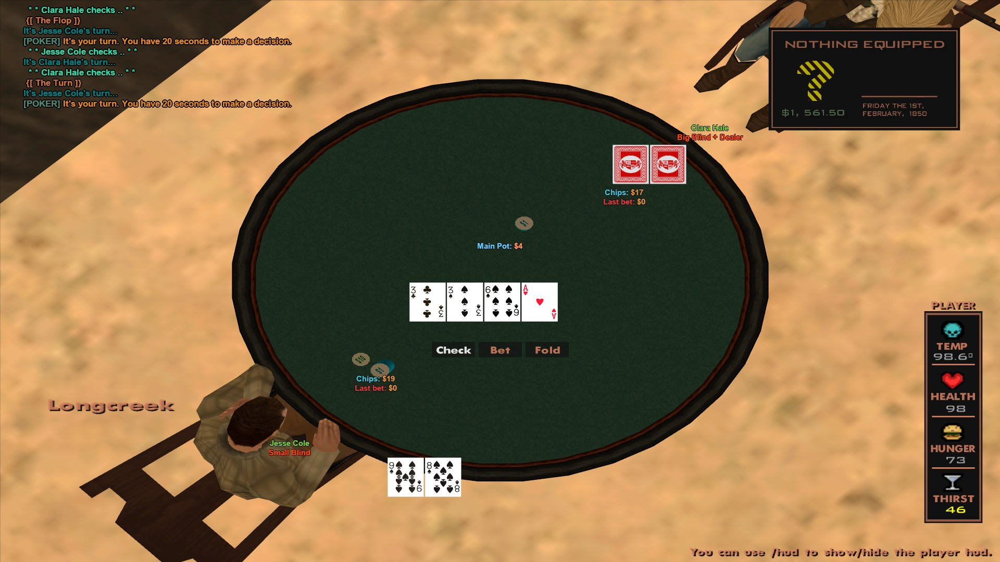 | 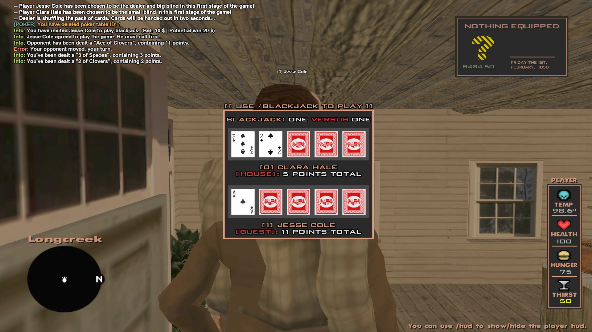 |
| 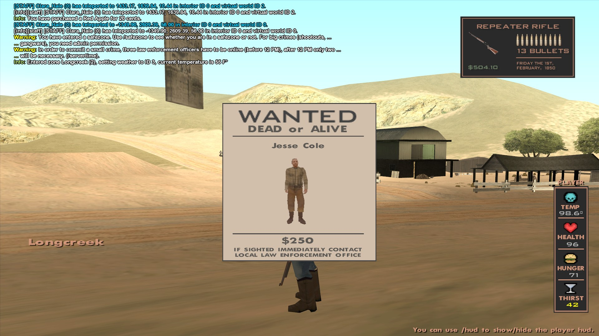 | 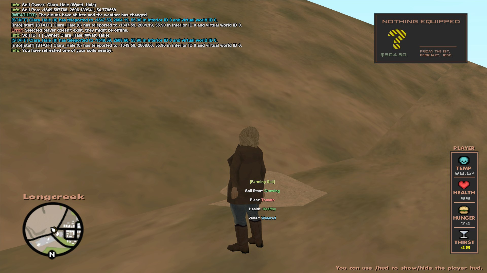 |
| 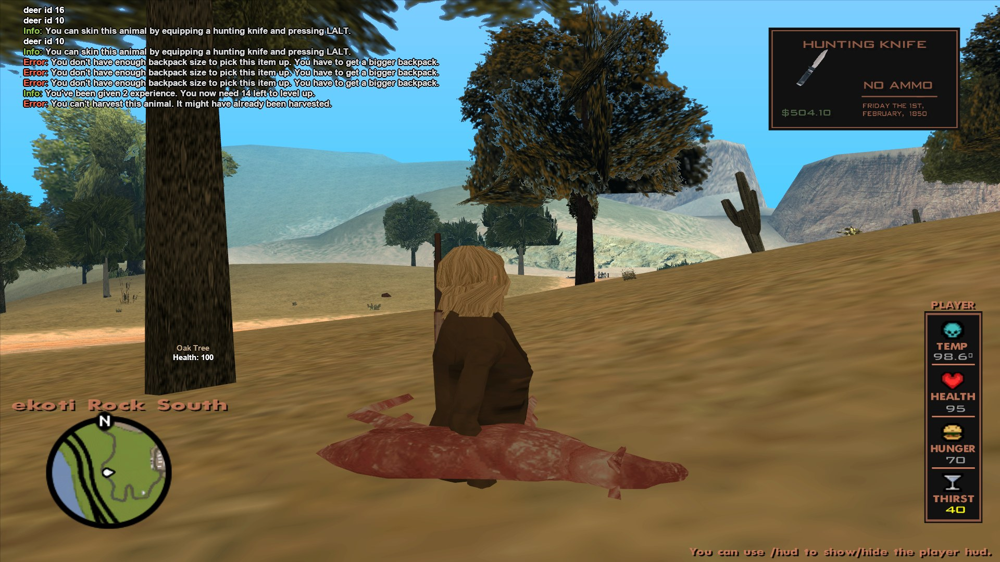 | 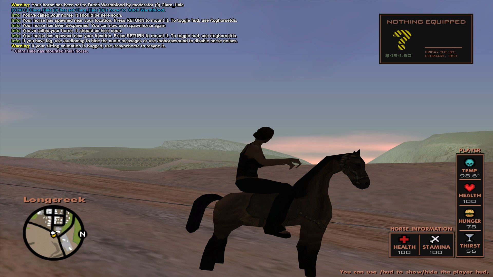 |

## Building and running

You need [sampctl](https://github.com/Southclaws/sampctl), the [open.mp server](https://github.com/openmultiplayer/open.mp/releases) (1.6.7 or newer), MariaDB or MySQL, and a SA-MP 0.3.DL client to connect with.

Build the gamemode:

```
sampctl ensure
sampctl build linux
```

Or `sampctl build` on Windows.

Set up the server:

- Unpack the open.mp server somewhere and copy `gamemodes/`, `models/`, `scriptfiles/` and `config.json` from this repo into that folder.
- Make sure your plugins folder is correct (sampctl should take care of this but just incase) crashdetect 4.22, PawnPlus 1.5.3, streamer 2.9.6, MySQL R41-4, samp_bcrypt 0.4.1 and ColAndreas 1.5.0 (the static build, `ColAndreas_static`).
- Put sscanf 2.13.8 in `components/`. Copy any extra files a plugin's release ships with, like the MySQL plugin's libraries on Windows.
- Configure rcon and `network.public_addr` or `artwork.cdn` as you would any regular 0.3DL server.

Set up the database:

- Create an empty database and a user for it.
- Rename `mysql-example.ini` to `mysql.ini` in the server folder and fill it in.
- The migration script will create the DDL on first boot.

You can place shops, houses and other points yourself in game with `/apoint` (managers).

Start it with `./omp-server` (or `omp-server.exe`) and connect with a 0.3.DL client on port 7777.

## Changes and fixes

### Server
- Built for open.mp 1.6.7 and the 0.3.DL client, with every custom model, skin and the horse animations served by the artwork component
- Fixed seven custom skins that never loaded
- Removed rigged GTA objects in the old maps (spray tags, train barriers, ...) since they would crash your client.
- IMPORTANT!!!: `config.json` raises `network.message_hole_limit` to 10000. This is INTENTIONAL! With the default of 3000, walking out of a mapped interior will stream hundreds of thousands of foliage objects! Enough objects to get the player kicked and their IP blocked for a while... So do not change this!
- Added `/gmx` for managers: a 30 second countdown that refunds running blackjack games and ends poker tables before the restart

### Accounts
- Fixed failed password tries resetting on every reconnect
- Fixed quiz questions 0 to 2 never being asked
- Fixed `/selectcharacter` accepting negative slots and never loading the chosen one

### Money
- Fixed `/pay 0 99` creating money when your hand was empty
- Fixed `/bank withdraw 0 99` creating money on an empty account
- Fixed cents getting lost on reload
- Fixed `/bail` never taking the money
- Fixed `/givemoney` accepting negative amounts
- Fixed selling a point throwing away the till money and the stored weapons

### Inventory, weapons and horses
- Fixed items above the stack limit getting lost
- Fixed `/pickupgun` destroying the gun even when giving the weapon was refused
- Fixed `/saddlebag store` overwriting an occupied slot and losing the weapon in it
- Horse prices and the revive are charged in dollars, as the texts say

### Jobs, farming and traps
- Fixed the ore table being swapped. Gold now comes from about 16% of rocks.
- Fixed harvesting never giving a basket. Only the plot owner can harvest, and a harvested plot goes back to an empty hole.
- Fixed anyone being able to disarm and pick up another player's trap
- Fixed `/cooldowns` clearing a running mining cooldown for free

### Posses and law
- Fixed `/prison` accepting 0 or negative minutes
- Fixed anyone near a wanted poster being able to remove any poster
- `/possekiosk take` (the weapon locker) needs tier 2, clearing a charge needs the officer near the player, and you can no longer put a bounty on yourself to inflate the economy
- `/wounds` is staff only, since any player could add fake wounds

### Games
- Poker is rewritten from the Texas Hold'em rules with a new hand evaluator. The table keeps its look.
- Blackjack and poker use my [omp-playing-cards](https://github.com/DignitySAMP/omp-playing-cards) library for the deck and the card sprites
- Blackjack bets are held by the house until the hand ends. A timeout or a kick refunds the bet, quitting forfeits it, and every leave is logged so nobody can crash out of a losing hand.

### Finished systems
- Telegrams: buy a number for $500 at the post office, then `/telegram` and `/viewtelegrams`
- The lottery: $1 tickets at the post office, an hourly draw, and online holders of the number split the pot
- The anticheat is rewritten on events with a single tick timer now, although I highly recommend not relying on it since it's very old!

## Credits for the port

- Banana_Ghost for iptrace, which the original used for `/geoip`
- Gammix for PreviewModelDialog, which the shop picture menus are based on
- ThreeKingz for TPoker, and LorenC, whose SF-CNR version of it the original poker table was taken from
- The authors of the libraries this runs on: open.mp, PawnPlus (IS4Code), pawn-plus-mysql and pp-hooks (AGraber), tdialogs (TommyB123), the MySQL plugin (pBlueG), streamer (Incognito), sscanf (Y_Less), strlib (oscar-broman), SmartCMD (YashasSamaga), samp-bcrypt (Sreyas-Sreelal), ColAndreas (Pottus) and crashdetect (Zeex)

---

## Wild West Roleplay (original legacy release)

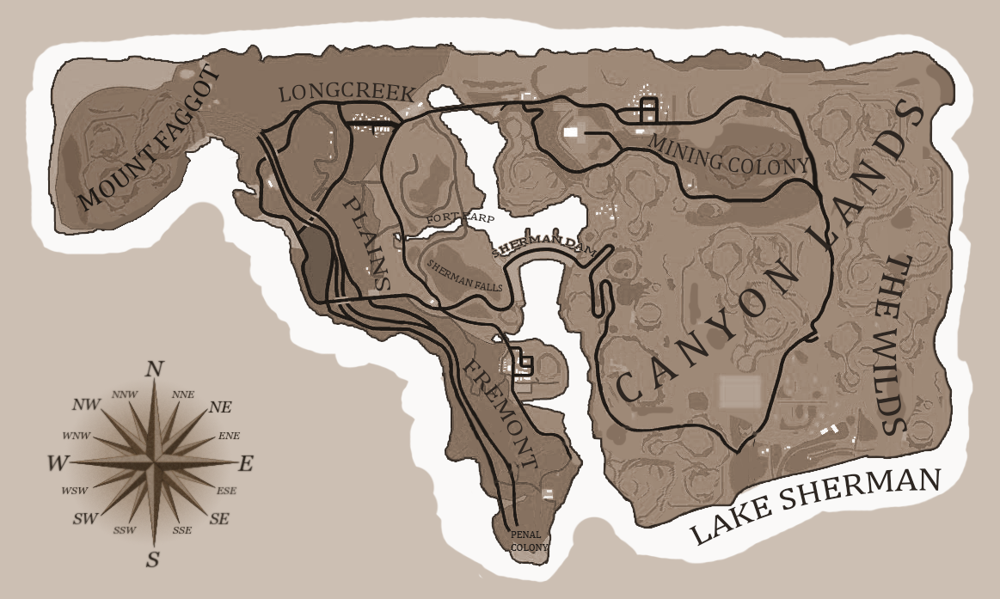

This was the magnum opus gamemode that established my name in SA-MP in 2016 to 2018. It is a roleplaying server with heavy RPG elements that took SA-MP to a completely new level back in 2016: the entire map is reworked, it has a custom horse system for vehicles, and a ton of RPG elements previously unseen in SA-MP (we pioneered them).

This server originally launched in 2016 and had a peak of 90 players. It lasted about four or five months before our inexperience (mostly on a management scope) caused the server to implode. During the development of Medieval Roleplay, it was reopened in 2018 with many updates to showcase the power of SA-MP 0.3DL (fully animated horses, custom towns, custom attachment models, ...).

Credits to the developers:
 - DignitySAMP (project lead)
 - DTVSamp (main developer)
 - Rusu (main developer)

If you are curious to see what the server looked like when it was up (https://www.youtube.com/watch?v=Me0RweOwJLk):

[](https://www.youtube.com/watch?v=Me0RweOwJLk)


I hope that with the release of this script, people can look at some of our techniques, innovative solutions and learn from our mistakes.

## Feature list

> Please keep in mind that I may have forgotten some features. This server was last live in 2018, and I simply skimmed the files and went by memory to describe them.

Account system
 - Basic randomized RP quiz (different options on every attempt)
 - Basic tutorial (currently not used, but should still work. Outdated as of WW-RP V2).
 - Basic new player task system which replaced the tutorial system 
 - Basic experience / level system.
 - Interactive textdraws on registration where you choose gender, race, town, skin and age.
 - Spawn selection method that automatically puts you into ajail, prison, crash position, predefined spawnpoint (house, business, town, ...)
 - Master account system (multiple characters with custom textdraws for selection)
 - Namechange system (character/account) 
 - /relog (/logout)

Horse script
 - The 'infamous' horse script from Medieval Roleplay
 - Different horse models, all are animated serverside
 - Completely removes the need for vehicles, essentially a 'custom' vehicle
 - Dismounted ("parked") horses can be damaged.
 - Custom sounds for horses (but the files are lost to time, alas...)
 - Textdraws for horse speed and health

Hunting script
 - Deers dynamically roam the map. Very basic AI (they will avoid mapping and not collide with anything, dynamically turn around. Every path is 'unique' in that regard).
 - Deers are custom models and are animated in the same way horses are - using a basic frame script.
 - You shoot deers, some weapons do more damage than others.
 - Shot deers can be skinned, giving you stuff to sell in the general stores and food.
 - Skinned deers turn bloody and despawn over time, inspired by RDR-2.
 - Basic skinning animation, you need a hunting knife for this. This is an endgame job.

Primary needs system
 - Hunger system
 - Thirst system
 - Temperature system (you get cold if you go too far north, use campfires or thermal clothing to combat hypothermia)
 - GUI that covers the default GTA SA HUD to display these
 
Custom mapping
 - Custom map on login/register screen
 - Custom spawn area
 - Las Barrancas and El Quebrados are completely remapped with custom models
 - Bayside was added in WW-RP V2 - snow area. You need thermal protection or you will freeze. "Endgame" town.
 - Foliage system procedurally generated across the entire map
 - Custom prison map (more info below)
 - Tons of interior maps that fit the aesthetic
 - Has remnants of Medieval Roleplay's models, which if you're interested in it, you can access here too.
 - All roads are changed to sand or mud variants for immersion
 - Blocks out unused areas of the minimap by adding black gangzones
 - Custom 'zone' messages that pop up and can be detected serverside


Inventory system
 - Fully textdraw based
 - Cooking system (predefined campfire locations)
 - Backpack sizes (ability to upgrade slots)
 - Item rarities like in World of Warcraft
 - Can show items to other players by using /showitems
 - Dropping and picking up items (has some dupe fixes, but not recommended for use)
 - Lots of predefined (hardcoded) items
 - Item discarding
 - Item usage method
 - Helper methods for decreases (including sub-methods for per params), increases, and more

RPG skill system
 - Ability to level up different 'skills' to improve your gameplay experience
   - Weapon movement (weapon skill level)
   - Aim skill (shaking when aiming)
   - Holster skill (time needed to (un)holster weapons)
   - Job skills: fishing, woodcutting, mining, hunting, farming, blacksmithing
   - Swimming (swimming has to be unlocked, different tiers make you able to swim longer else you pass out and wash up on the shore, eventually you can swim freely)
   - Health (unused)
   - Fight style
   - Unarmed damage
   - Knife usage
   - Knife throwing


Weapon system
 - All weapons are custom, there is a GUI showing unholstered weapon and bullets in the chamber
 - Bullets are tracked serverside - intuitive reload system. You can run out of bullets but keep your weapon.
 - Bullet shells are dropped when a gun is fired, can be investigated by a sheriff
 - Holstering system that plays in with the GUI (holster in pocket, on back or on gun belt). This is visible on the player.
 - Blacksmithing system where you can craft guns (including rare weapons) using mining ores
 - Ability to pass and drop/pickup weapons
 - Ability to switch equipped weapon with one that is holstered
 - Ability to modify attachment position of holstered weapons
 - Weapon skill must be learned - as a new player you will shake when you aim, move slowly and unholster slowly. You level individual skills to improve by spending experience points.

Money system 
 - Supports 'change' (i.e. $12.75).
 - Realistic values inspired by RDR-2 (if you have $100, you are essentially upper class).

Damage system
 - Bleeding system (blood trail following you) - use bandage to prevent
 - Visible blood splatters on screen (textdraws) when you get damaged
 - Serverside explosions and fire damage
 - Broken leg system (can't sprint or jump, you will tumble)
 - Dying will create a corpse that can be carried/burried/burned) - used for sheriff's and/or crime RP.
 - Taking damage dismounts you from riding a horse
 - /showinjuries to show current damage
 - /showwounds to show open wounds

Job system
 - Fishing
 - Chopping trees
 - Mining ore
 - Uses the same principle: a progress bar shows up and you need to 'fight' it by spam clicking, gets harder over time depending on skill level and node difficulty)
 - Goes hand in hand with the skill system - upgrade skills to unlock better nodes.
 - All of the fish, lumber or ores go hand in hand with other systems (furniture, creating guns, cooking food, ...)
 - Uses custom textdraws (action panel) that is reused throughout all jobs and activities creating a familiar and intuitive interaction window
 - You sell job supplies in specific stores for money, sort of like deliveries

Minigames
 - Poker (taken from LorenC's SF-CNR, edited to fit the WW-RP aesthetic)
 - Blackjack (basic textdraws, multi player support VS house)


Beard system
 - Never hooked into production, but is a semi finalised system.
 - You dynamically grow a beard over time, inspired by RDR-2.

Lasso system
 - You need to be part of law enforcement
 - You can throw a lasso at somebody to pull them off their horse
 - You can tie people up with your lasso

Traps
 - You can place traps around and catch players and animals
 - Triggers bleeding on players
 - RPG-like elements: arming, disarming, examining, ...


Donation system
 - Work in progress, very bare bones.
 - Different donation levels
 - Private donation chat
 - You earn more money per paycheck
 - Donator only horse
 - Automatic donator removal


Dynamic actors
 - Predefined types for business types
 - Actors can be completely customised by admins (set anim, set facing pos, create, delete, edit, ...)
 - You can interact with actors by pressing H (boilerplate set up, no functionality (yet).

WIP farm system
 - Able to plant soil
 - Able to plant a variety of plants
 - Soil states (empty, dug, seeded, growing, grown)
 - Water states (dehydrated, moderated, watered)
 - Health states (dead, diseases, thirsty, healthy)


Dynamic points system (Businesses)
 - Predefined types (general, firearms, clothing, barber, liquor, saloon, hunting, bank, postal, sheriff, blacksmith, stablemaster)
 - Renting at points
 - Storing weapons in points
 - Basic till system (hardcoded item buy prices)
 - Motels for new players to rent at for a cheap price
 - Furniture system (textdraw based)
 - Advertisement system
 - Telegram system (letter system: send mail from business A to business B)

Dynamic posse system (Factions)
 - Kiosks (weapon lockers) can be set up for any posse, but default to sheriff faction
 - Charge system for sheriffs
 - Prison system for sheriffs
 - Intuitive radio system - uses transmission poles that jumble up the text based on range (fictional telephone signal towers)
 - Tackle system for sheriffs
 - Different chat color based on types (Default, law, government, gang)
 - Ability to view a list of all posses and their online members

Wanted poster system
 - Textdraw for wanted posters
 - Police can create wanted posters at any location (using object editing)


Admin system
 - Management tier (able to create stuff dynamically, assign roles, ...)
 - Admin tier (moderation, anti ban evading system, ...)
 - Helper tier (able to recieve and answer questions, sub-groups such as developer, event, faction and mappers)
 - Admin records and admin notes
 - Center on Cell command for teleportation (inspired by Skyrim)
 - Staff island mapping (/staffisland)
 - Many more commands to make moderation intuitive


Revision system
 - Ability to track updates using /updates
 - You get informed of updates when you log in

Animation system
 - Lots of small animations to make your roleplaying experience immersive (/anims)
 - Preloading animations

Anticheat system
 - This is EXTREMELY outdated (<2016). Don't expect anything to work.
 - Detects the following:
   - Money hacks
   - Health hacks
   - Weapon hacks
   - Ammo hacks
   - Airbreaking
   - C-bugging
   - Autobans disallowed weapons
   - Ban evasion
   - Teleport hacks
   - Speed hacking

Attachment system
 - Ability to buy attachments at different points
 - Ability to modify the position of attachments
 - Ability to modify the attached bone of attachmnets
 - Some attachments provide better protection against health when going to a winter area

Campfire system
 - Used to increase the 'temperate' character trait
 - Can add fuel to prolong the time and increase heat.


Dynamic label system
 - Admins can create 3d text labels on demand.
 - Players can request 3d text labels that admins can approve (used for roleplay scenes, inspired by VWH-RP).

Rudimentary lottery system
 - Buying tickets add to the pot
 - Uses default random() for RNG
 - Multiple winners possible - pot is automatically split

Miscalleneous systems
 - Anti spam (command)
 - Attributes system (/examine, /attribute) for roleplay
 - Fading system (/blindfold and fadein/fadeout used throughout the script)
 - Mask system (attached object that can be changed, /editmask to change the position)
 - Message of the day system (hardcoded)
 - Pause detection
 - Shake hands system (/shakehand)
 - Basic serverside time handler (custom time: 1 ingame day = 288 irl minutes)
 - Frisking system
 - /coin and /rolldice
 - Custom nametags (3d text labels) to hide health bar
 - Roleplaying commands and chat animations
 - Accent system
 - Dynamite system (serverside explosions, can only be given by admins, kills players depending on radius and creates serverside fires)
 - Session tracking
 - Fast travel points (transport system)

Dynamic gate system
 - Can be bound to players, factions or be for public use
 - Created by admins, uses /gate and dynamic objects

